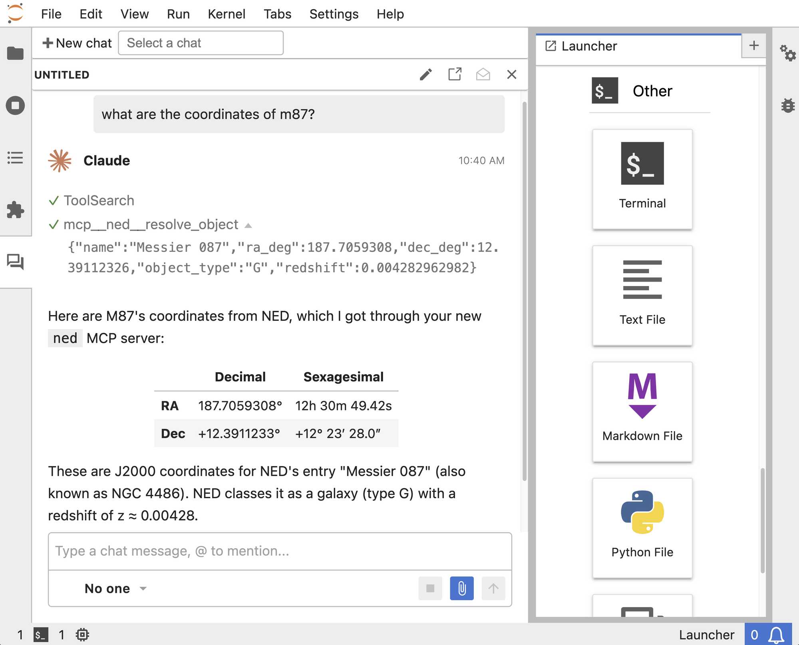

# Build, Inspect, and Run an MCP Server

> This tutorial is the live demo from the talk
> **"AI Tool Use for Astronomy, and MCP for Data Archives"** by Dan Gause and
> Adele Plunkett (NRAO), presented in the
> [NASA AI/ML STIG Lecture Series on 9 November 2026](https://science.nasa.gov/astrophysics/programs/cosmic-origins/community/ai-ml-stig-lecture-series-9-nov-2026/).
> The talk covers what MCP is, examples of MCP servers in astronomy, and
> MANNA, an MCP server for the NOIRLab and NRAO archives. This repo lets you
> work through the "build an MCP server" demo on your own.

A short hands-on tutorial: use Claude Code to **create** a small
[Model Context Protocol](https://modelcontextprotocol.io) (MCP) server,
**inspect** it to confirm it works, then **run** it so Claude can use it.

The server, `ned`, exposes one tool: `resolve_object(name)`. It looks up an
extragalactic object (e.g. "M87") in [NED](https://ned.ipac.caltech.edu) and
returns its J2000 coordinates, object type, and redshift.

```
  Claude  ──MCP (stdio)──▶  server.py  ──HTTPS──▶  NED ObjectLookup
          ◀── result ─────            ◀── JSON ──
```

## What's here

| Path                 | Purpose                                                  |
| -------------------- | -------------------------------------------------------- |
| `prompt.txt`         | The prompt you give Claude Code to build the server       |
| `workspace/`         | Empty folder: build your server here                      |
| `solution/`          | A finished, working server, if you get stuck               |
| `PRESENTER_NOTES.md` | Run-of-show for presenting this as a live demo            |

## Prerequisites

- [Claude Code](https://docs.claude.com/en/docs/claude-code)
- [uv](https://docs.astral.sh/uv/) (Python package and project manager)
- [Node.js](https://nodejs.org) (only needed for the MCP Inspector web UI)
- The `mcp-server-dev` plugin. Install it inside Claude Code:

  ```
  /plugin install mcp-server-dev@claude-plugins-official
  ```

## Step 1: Create the server

```bash
cd workspace
claude
```

Paste the contents of [`prompt.txt`](prompt.txt) into Claude Code. Claude
uses the `mcp-server-dev` plugin to set up a uv project and write `server.py`.

Read the generated `server.py` before you go on. Things to notice:

- `FastMCP("ned")` creates the server.
- `@mcp.tool` turns a normal Python function into an MCP tool.
- The **docstring and type hints** are what Claude sees. They tell the model
  what the tool does and when to use it.

## Step 2: Inspect the server

Test the server before you connect it to Claude. All commands run from
`workspace/`.

**From the terminal:**

```bash
uv run fastmcp list server.py                              # what tools exist?
uv run fastmcp call server.py resolve_object name=M87      # call one
```

**In the browser (MCP Inspector):**

```bash
uv run fastmcp dev inspector server.py
```

In the Inspector, click **Connect**, open the **Tools** tab, click
**List Tools**, choose `resolve_object`, enter `M87`, and click **Run Tool**.
You should see something like:

```json
{
  "name": "Messier 087",
  "ra_deg": 187.7059308,
  "dec_deg": 12.39112326,
  "object_type": "G",
  "redshift": 0.004282962982
}
```

## Step 3: Run it with Claude

Register the server with Claude Code (run this from `workspace/`):

```bash
claude mcp add ned -- uv run --directory "$(pwd)" server.py
claude mcp list        # ned should show as connected
```

Start a **new** Claude Code session in the same folder, then ask:

> What are the coordinates of M87?

Claude should call `resolve_object` and answer with the NED result. Type
`/mcp` inside Claude Code to see the server and its tools.

## Optional: Use it from JupyterLab with Jupyter AI

MCP is not tied to one client. In this step, an AI chat in JupyterLab uses
the same `server.py` without any changes, through
[Jupyter AI](https://jupyter-ai.readthedocs.io) (v3).

**1. Tell Jupyter AI about the server.** Jupyter AI reads MCP servers from
`.jupyter/mcp_settings.json` at the root of your workspace. Run this from
`workspace/` to write that file with the correct absolute path:

```bash
mkdir -p .jupyter
cat > .jupyter/mcp_settings.json <<EOF
{
  "mcp_servers": [
    {
      "name": "ned",
      "command": "$(which uv)",
      "args": ["run", "--directory", "$(pwd)", "server.py"]
    }
  ]
}
EOF
cat .jupyter/mcp_settings.json      # check the paths look right
```

This is the same command you gave `claude mcp add` in Step 3, written as
JSON. Note that `args` is a list of strings.

**2. Pick an agent for the chat.** Jupyter AI does not include a model. It
connects to an agent you already have. You have Claude Code installed, so
install its ACP adapter, which lets Jupyter AI talk to Claude Code:

```bash
npm install -g @agentclientprotocol/claude-agent-acp
```

**3. Start JupyterLab from `workspace/`.** `uvx` installs JupyterLab and
Jupyter AI in a temporary environment, so your server's project stays as it
is:

```bash
uvx --from jupyterlab --with jupyter-ai jupyter-lab
```

**4. Chat.** In JupyterLab, click the **Chat** card in the Launcher (or the
**+** button in the chat side panel). In the chat input toolbar, open the
persona menu and select **Claude**. Then ask:

> What are the coordinates of M87?

Claude should call `resolve_object` from inside JupyterLab:



> **Tips**
> - Jupyter AI reads `mcp_settings.json` when it starts. If you edit the file,
>   restart JupyterLab.
> - Start `jupyter-lab` from `workspace/`. Jupyter AI looks for `.jupyter/`
>   in the folder of the chat file and its parent folders, and stops at the
>   folder you started JupyterLab from.
> - If Claude asks you to log in, run `claude` in a terminal once to sign in,
>   then try again.
> - Want a different model? The built-in **Jupyternaut** persona can use any
>   [LiteLLM](https://docs.litellm.ai/docs/providers) model with your own API
>   key, and it also loads `mcp_settings.json`. Start JupyterLab with
>   `--with 'jupyter-ai[jupyternaut]'`, then set the model and key under
>   **Settings → Jupyternaut settings**.

## Try next

- Ask about a star, such as "Where is Vega?". Does Claude still use the tool?
  How does the docstring affect that choice?
- Add a second tool, such as one that searches for objects near a position.
- Connect the same server to Claude Desktop or another MCP client. The
  JupyterLab step above shows one example.

## Start over

```bash
claude mcp remove ned -s local        # run from workspace/
cd workspace && rm -rf ./* .venv .jupyter
```

**Stuck?** Copy the finished version with `cp solution/* workspace/`, then
continue from Step 2.
